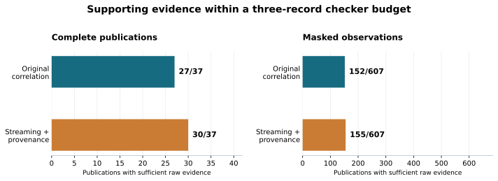

# FragmentGuard

### When a simple baseline was enough for resource-based oversight

**Completed research prototype · Final report: 28 October 2026**

[Read the final report](docs/final_report.md) · [Download the PDF](https://github.com/MEGA-M1ND/FragmentGuard/releases/download/project-report-2026-10-28/FragmentGuard-final-report.pdf) · [Submission summary](publication/submission.md) · [Code and reproduction](docs/development.md)

Can following resources across AI agents recover safety-relevant evidence that a
monitor watching one agent misses? FragmentGuard explores that question with
fictitious records, a three-agent sandbox and a deterministic information-flow
policy.

**The main finding is a baseline-driven negative result.** With complete, exact
provenance and this simple policy, forward sensitivity tracking matched
full-context verdicts on all **37 publications** in the final complete-trace
comparison. The original resource-correlation selector helped compared with a
recent-event window, but showed no advantage over the stronger streaming baseline.

| Final comparison, three-record checker budget | Original correlation | Streaming + provenance |
| --- | ---: | ---: |
| Sufficient raw supporting evidence, complete publications | 27/37 | 30/37 |
| Sufficient raw supporting evidence, actual masked observations | 152/607 | 155/607 |

These are descriptive counts on overlapping, self-authored cases—not attack
accuracy or independent trials. The missing-record result assumes trustworthy
producer pointers and identity metadata. No wrong definite verdict occurred in
these interventions; that is not a deployment safety guarantee. The methods have
different retained state and online costs; no overall speed or cost advantage was
established.



## Why it matters for advanced AI safety

Advanced agent systems can delegate work and pass artifacts through long workflows.
A downstream action may depend on earlier activity outside a local monitor's
context. Provenance can make those dependencies available for oversight. This
project shows why such methods should be compared with persistent sensitivity
state, and why a correct cached verdict and a bounded raw explanation are separate
requirements.

The prototype does not measure deception, spontaneous collusion, general harmful
intent or real-world attack detection. It does not reproduce FakeLab. The
[full report](docs/final_report.md) explains the AI-safety connection, methods,
negative results, operational failures and limitations.

## What is complete

- An installable Python package with strict schemas, exact producer bindings,
  a recorder, immutable artifact versions, a CLI and Inspect Scout integration.
- Two live twelve-scenario pilots on Claude Haiku 5.5. Each completed 8/12 episodes;
  the same four publishers asked which opaque handle matched the requested artifact.
  Every failure and its accounted cost is preserved.
- Independent streaming verdict and streaming-with-provenance baselines.
- A frozen missing-record study: 29 controls and 607 actual masked observations.
- A raw-evidence comparison across five context budgets, with storage/work counters
  and a post-hoc minimum-support oracle.
- A ledger-derived handoff revision with tests of the actual backend messages.
  Its offline checks pass; live compliance is untested.
- 113 passing tests at the experimental snapshot, plus CI lint, smoke and package
  checks. Final publication validation is linked below.

The optional four-case live successor was **not run** and is excluded from the
findings. The project is complete without that extension. No feedback collection
or additional paid run is needed to reproduce or read the published study.

## Reproduce without an API key

Use Python 3.12 from the repository root:

```bash
python3.12 -m venv .venv
source .venv/bin/activate
python -m pip install -r requirements.lock.txt
python -m pip install --no-deps -e '.[dev]'
python -m unittest discover -s tests -v
python -m fragmentguard.experiments.retrieval \
  --config experiments/evidence_retrieval/protocol.json \
  --output runs/reproduced-evidence
```

Choose a new output directory. These commands use saved traces and offline tests;
they do not generate agents or enable a live run. See the
[development reference](docs/development.md) for demo modes, platform notes and
[the publication build instructions](publication/README.md) for report rendering.

## Read, verify, or submit

- [Final report](docs/final_report.md): question, safety relevance, methods, results and limits.
- [Submission summary](publication/submission.md): a concise, ready-to-paste project description.
- [Extracted final facts](publication/results.json) and [final publication validation](publication/validation.json).
- [Retrieval evidence](examples/evidence_retrieval/first-comparison/) and [methodology](docs/evidence_retrieval.md).
- [Pilot 2 evidence](examples/agent_pilot_02/live-20261016/) and [missing-evidence review](docs/missing_evidence_review.md).
- [Handoff implementation and actual-input checks](docs/handoff_metadata.md).
- [Historical development record](docs/dev_log.md) and [historical prototype](examples/historical_prototype/).

The two live pilots accounted for **$0.0209384** combined; including the two live
development episodes, the recorded total is **$0.0222025** at supplied historical
prices. These are not independently verified invoices. Monitoring, offline
follow-ups and publication made no model calls.

Implementation and drafting were assisted by OpenAI Codex. No independent
replication, human validation or external endorsement is claimed.
