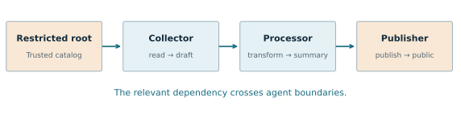

# FragmentGuard: when a simple baseline was enough

*A project on resource provenance and oversight of multi-agent AI workflows. Final report · 28 October 2026.*

## The result in one paragraph

A summary may look harmless to the agent publishing it even when another agent produced it from confidential material. **Can following that history improve oversight—and does it outperform simply remembering which artifacts are sensitive?** FragmentGuard tested both approaches in a controlled three-agent workflow. With complete, exact provenance (the recorded history of how artifacts were produced), simple sensitivity tracking matched full-context decisions on all **37 publications**. When required to return original records supporting a decision, tracking with stored provenance supplied sufficient evidence for **30/37 publications** within a three-record budget, compared with **27/37** for the original correlation selector. The initial advantage over recent-event monitoring disappeared against the stronger baseline. These are descriptive results on self-authored cases, not real-world detection rates.

## Why this matters for advanced AI safety

Advanced AI agents may delegate work, use tools and pass artifacts through long workflows. A consequential action can depend on earlier activity by several agents. A monitor with only the publishing agent's local context may see an ordinary-looking final action while missing the information needed to judge it.

That motivates a practical oversight question: **which history must an oversight system retain or retrieve to assess a downstream action?** Resource provenance provides one possible organizing structure. If an output was derived from a restricted input, the dependency should survive handoffs and transformations.

The project's theory of change is concrete: delegation spreads relevant history across agents; a recorder preserves dependencies; persistent state or evidence retrieval makes those dependencies available when a downstream action is assessed. A system could use that assessment to request review before an external publication. This study evaluates the assessment step; it does not measure whether intervention prevents harm.

The evaluation gap addressed here is the comparison with **persistent memory of the same provenance**. A monitor can appear better simply because a weaker baseline forgets relevant history. Testing that explanation helps oversight researchers decide whether to invest in a more elaborate selector, a simpler policy check, or better recording. The baseline uses familiar information-flow or “taint” tracking: sensitivity propagates from inputs to outputs. The contribution is the auditable comparison and its limits, rather than a new propagation algorithm.

This is relevant to AI control and oversight, but it does not test deceptive planning, spontaneous collusion or general harmful intent. The motivating paper, *Multi-Agent AI Control: Distributed Attacks Hamper Per-Instance Monitors*, concerns a broader problem [1]. FragmentGuard does **not** reproduce its attacks or run FakeLab. Instead, it isolates a much simpler mechanism: whether an explicit resource dependency remains visible across agents.

## A concrete example

A collector reads a restricted document and produces a draft. A processor turns the draft into a summary. A publisher releases the summary publicly. A monitor watching only the publisher knows a publication occurred, but cannot establish where the summary came from. Following the resource chain can recover that history.



*Figure 1. The records are fictitious and the publication destination is a local sandbox. A resource dependency, not the agents' stated intentions, determines the toy-policy verdict.*

The trusted catalog labels roots `public` or `restricted`. Transformations preserve restriction status: there is no redaction or declassification rule. A public publication receives:

- **Alert** if at least one restricted ancestor is established, even if another branch is unresolved.
- **Clear** if its entire ancestry is established as public.
- **Insufficient evidence** if ancestry is unresolved and no restriction is established.

Internal publications are allowed under the toy policy. An incomplete workflow is an execution outcome, not a clear or uncertain monitoring verdict.

## What I built and compared

The implementation is an installable Python package with a CLI, strict event validation, immutable artifact versions, a recorder and a deterministic checker. Collector, processor and publisher act sequentially in a sandbox. Models can choose tool calls, but the application computes artifact content; this is not unrestricted agent behavior. Successful operations are recorded before acknowledgment. The normalized producer bindings in recorded episodes are checked against the execution ledger. Synthetic logs use a shared complete-log binding pass; the compatibility path is not an end-to-end streaming recorder.

The original experiment compares four evidence views using the same checker:

| View | Information presented at publication |
| --- | --- |
| Per-agent | The publishing agent's recent actions |
| Recent-event window | The latest events across agents |
| Resource correlation | Events retrieved by following exact producer references |
| Full context | All available earlier records; a diagnostic reference |

The original bounded views use at most three selected events, including the publication, with a 100-tick horizon. Correlation explores depth-first in declared input order. Its budget and priority were kept fixed in the recorded pilots.

Two stronger baselines were then added. **Streaming sensitivity** processes arriving events and retains each produced version's restriction and uncertainty state; its verdict requires no backward walk at publication. **Streaming with provenance** also stores parent pointers and retrieves a bounded raw-record witness, visiting known-restricted parents first. Both are independent of evaluator labels. The latter is itself a provenance-retrieval system: the comparison is between concrete implementations, not a claim that all correlation methods are inferior.

The checker calls no language model. Inspect Scout integration was exercised both directly and through its real scheduler [2, 3]. Scheduled replays reported zero tokens and empty model usage.

## What was tested

| Evidence set | Scope and role |
| --- | --- |
| Four bundled fixtures | Deterministic integration cases |
| Scripted rehearsal | Twelve scenarios forming six matched pairs; exercises executor and recorder |
| Live pilot 1 | Twelve attempts on Claude Haiku 5.5; eight completed |
| Live pilot 2 | Twelve new attempts with four clarified publisher instructions; eight completed |
| Stale-write regressions | Five publication targets testing exact producer resolution |
| Missing-record interventions | 636 observations of 29 targets: 29 controls and 607 actual masks |

The final complete-trace comparison contains **37 publications: 4 + 12 + 8 + 8 + 5**. These sets reuse case structures and are not independent samples. They were designed alongside the checker; no held-out performance estimate is claimed.

A separate evaluation path derives expected publication labels from the execution ledger after generation. Method outputs are written before evaluator labels are joined. Those labels check implementation consistency with the declared policy; they are not independent human judgments about real-world harm.

## Finding 1: the stronger verdict baseline was sufficient

In live pilot 2, correlation resolved **7/8 completed publications**, while the recent-event window resolved **4/8**. Forward sensitivity tracking and full context agreed on **8/8**. The same agreement extended to all **37 complete publications** in the final comparison.

This is the main result: complete, exact resource information and a monotone sensitivity policy make the decision amenable to ordinary propagation. The original correlation-versus-window comparison alone would have overstated what correlation added.

**Why the baseline works.** For each transformation, the rule is `restricted(output) = any restricted(input)`. Catalog labels initialize the roots. If the input flags correctly summarize their ancestors, applying this rule makes the output flag correct too. Repeating that argument along a complete, correctly ordered dependency graph gives the same restriction decision as walking the whole ancestry at publication. Missing inputs also propagate an unresolved state; a public publication is clear only when no restriction or unresolved input remains. Thus agreement is expected under this policy. The 37-case result checks implementation behavior; it is not statistical evidence that the method generalizes to richer policies. Redaction, permission changes or context-dependent rules would require a different argument.

Pair separation tells the same limited story. A method separates a pair only if it alerts on the actual violating twin and clears the actual allowed twin. Both live pilots had four evaluable pairs out of six; correlation separated three, the window two, per-agent zero, and full context and streaming four. These counts describe the evaluable pairs, not general attack-detection accuracy.

## Finding 2: retaining a verdict is different from supplying a proof

A cached sensitivity flag can be correct even when a small raw-record view cannot establish the full dependency chain. The follow-up experiment therefore asked each selector to supply records that the **same checker** could use to establish a definite reference verdict. Both selectors received the same visible archive, catalog and exact producer metadata. Raw evidence outputs were saved before full-visible references and a small exhaustive minimum-support oracle were calculated.


*Figure 2. Sufficient raw supporting evidence at a three-record checker budget. The two panels have different denominators and are not pooled. “Masked” excludes no-deletion controls.*

| Checker budget | Complete: correlation / streaming + provenance | Masked only: correlation / streaming + provenance |
| --- | --- | --- |
| 1 record | 1 / 1 of 37 | 31 / 31 of 607 |
| 2 records | 3 / 5 of 37 | 51 / 53 of 607 |
| 3 records | 27 / 30 of 37 | 152 / 155 of 607 |
| 4 records | 35 / 36 of 37 | 154 / 155 of 607 |
| 8 records | 37 / 37 of 37 | 155 / 155 of 607 |

Some restricted ancestry lies on a short branch listed after a long public branch. The original selector can spend its budget on the public branch; the stronger baseline uses its cached restriction state to prioritize a short witness. At three records, it recovered three additional complete-case proofs. The scripted sc04 case also preserves an example where the recent-event window alerts while original correlation remains uncertain.

The comparison does **not** establish an overall cost advantage for either approach. Both retain access to a visible archive and bindings. Streaming adds online updates and retained state. For the complete cases at budget three, payload dereferences totaled 124 for correlation and 109 for the stronger baseline; declared checker-context encodings totaled 22,225 and 22,246 bytes. The stronger baseline's additional canonical state representation had a median size of 300 bytes per prefix, but that is not resident RAM or a minimum implementation cost. Model-token costs, latency and human explanation quality were not measured.

## Finding 3: missing payloads caused uncertainty under trusted pointers

Producer references were frozen **before** records were hidden. The target publication, visible input references and trusted identity headers remained available. Hidden input edges and contents were not supplied. Streaming state started empty for every observation; labels from the complete history were not retained.

Across the **607 observations with actual deletions**, correlation retained 152 definite verdicts, the window 74, and streaming and all-visible checking 155. No wrong definite verdict occurred. Streaming matched all-visible checking throughout; 452 masked observations were uncertain even with all visible records.

This supports conservative handling of unavailable payloads **when pointers remain trustworthy**. It does not test an unlogged write, a dishonest producer reference, missing identity metadata or ambiguous real-world resource identity. The six recorded window wins over correlation include three no-deletion controls and three masked observations. Masks are interventions on existing traces, not additional independent workflows.

## Finding 4: the live workflow failed for an operational reason

Both live pilots completed 8 of 12 attempts. The same four scenarios—sc04, sc05, sc09 and sc11—produced no publication, leaving difficult pairs B and F unevaluable live. Their publishers asked which opaque handle corresponded to the intended final artifact.

Pilot 2 clarified the requested names (`summary` or `report`), but the publisher still received a list such as `v002, v003` without a mapping. Although the tool supports names, the model did not use that capability. This instruction-only change did not resolve the handoff.

The final executor revision now includes a ledger-derived name-to-handle mapping, retains intermediates and replacement versions, and instructs recipients to use immutable handles. Offline tests inspect the actual backend message, including name replacement, background alias overwrite and missing targets. All twelve captured publisher inputs passed; a four-case successor rehearsal also passed. **Live compliance with that revision was not tested.** The proposed four-case paid successor was not run and is excluded from the final results. The project is complete without that optional extension.

## Execution quality, cost and reproducibility

The final implementation has **113 passing tests** at the recorded experimental snapshot, including generated-stream properties, stale-write regressions, integration checks, provenance retrieval and actual-message handoff tests. CI also checks linting, offline smoke runs and package builds. Final publication validation is recorded separately so it is not confused with experimental results.

Historical fixtures, freezes, failures and reports are preserved. No paid failure was retried or replaced. Source commits, input hashes, selected evidence IDs, unresolved references and budget ledgers are available with the data. The final retrieval experiment's portable runner reproduces the recorded scores byte-for-byte.

Pilot 1 made 77 requests and accounted for **$0.0105118**; pilot 2 made 76 and accounted for **$0.0104266**, including incomplete episodes. Their combined accounted cost is **$0.0209384**. Including two live development episodes, the recorded total is **$0.0222025**. These are usage times supplied historical prices, not independently verified provider invoices or predictions of future costs. No model calls were made for monitoring, the offline follow-ups or this publication.

To inspect or reproduce the main result without an API key, follow the repository's pinned Python 3.12 install and run:

```bash
python -m unittest discover -s tests -v
python -m fragmentguard.experiments.retrieval \
  --config experiments/evidence_retrieval/protocol.json \
  --output runs/reproduced-evidence
```

The output directory must be new. This command replays saved records; it does not generate agents or enable a live run.

## Limits and what would be worth continuing

The study uses one model, tiny self-authored cases and controlled application-computed content. It assumes exact version identity, a trusted catalog and restriction-preserving transformations. It measures neither general intent nor declassification, sophisticated adversaries or production logging. Baselines have different information and storage costs. A zero-error result on these interventions is not a deployment safety guarantee. No independent replication or external review is claimed.

The next research decision is whether the recorder assumptions survive a realistic agent system. Two concrete follow-ups would answer that:

- **Challenge the metadata, not just the payloads.** Introduce missing or incorrect producer references and unrecorded writes, keeping a separate execution ledger for evaluation. Measure incorrect clear decisions and abstentions using the same visible information for each method. This would locate the boundary where the present safety argument fails.
- **Test whether retrieved explanations justify their cost.** Use externally authored workflows and compare equal evidence budgets while measuring online work, retained storage and latency. Ask whether the returned records are sufficient to reconstruct the policy decision. An advantage would require better support or lower measured resource use under a declared recorder contract.

These are future experiments, not requirements for the completed project. Any live validation of the handoff revision would be a new protocol check, not a repair of the recorded pilots.

The completed contribution is an auditable prototype and a baseline-driven lesson: **before claiming an advantage for a multi-agent oversight method, compare it with persistent state that has access to the same provenance. Here, simple propagation was enough for verdicts, and the original selector showed no supporting-evidence advantage over propagation with provenance.**

## References and evidence

1. Makins et al., [*Multi-Agent AI Control: Distributed Attacks Hamper Per-Instance Monitors*](https://arxiv.org/abs/2607.07368), arXiv:2607.07368. Motivation only; no FakeLab reproduction.
2. [Inspect AI](https://inspect.aisi.org.uk/).
3. [Inspect Scout](https://meridianlabs-ai.github.io/inspect_scout/).
4. [Final complete/masked retrieval outputs and manifests](https://github.com/MEGA-M1ND/FragmentGuard/tree/aed2a1c969267e1f70dfeac8255daa9f4443ed13/examples/evidence_retrieval/first-comparison).
5. [Pilot 2 run, incomplete episodes and comparison](https://github.com/MEGA-M1ND/FragmentGuard/tree/20eb2cfcd834f3f53b2c4d6a71a1c7fbe6b34be9/examples/agent_pilot_02/live-20261016).
6. [Observation-contract review](https://github.com/MEGA-M1ND/FragmentGuard/blob/aed2a1c969267e1f70dfeac8255daa9f4443ed13/docs/missing_evidence_review.md) and [actual publisher-input checks](https://github.com/MEGA-M1ND/FragmentGuard/blob/aed2a1c969267e1f70dfeac8255daa9f4443ed13/docs/handoff_metadata.md).

*Implementation, test execution and drafting were assisted by OpenAI Codex. Scripted checks and live generation are distinguished above; no independent human validation is implied. The repository contains the full technical history and evidence, including negative and incomplete outcomes.*
