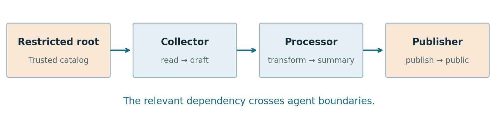
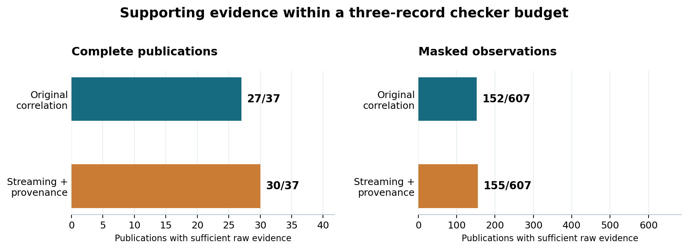

# FragmentGuard

## Resource provenance and oversight of multi-agent AI workflows

**Detailed research report · 29 October 2026**

**Central finding:** Under complete, exact provenance and a restriction-preserving information-flow policy, simple sensitivity propagation matched full-context decisions. The original correlation selector showed no advantage over a stronger baseline that retained sensitivity and provenance.

**Project:** MEGA-M1ND/FragmentGuard

**Status:** Completed research prototype. This report expands the existing study; it introduces no new experimental runs.

**Evidence snapshot:** `aed2a1c969267e1f70dfeac8255daa9f4443ed13`

**Presentation source:** Final report revision 2, commit `14d79bc3fd7c5d97175aba115681943d903e2f86`

**Repository:** <https://github.com/MEGA-M1ND/FragmentGuard>

Implementation, test execution and drafting were assisted by OpenAI Codex. No independent replication, external review or human validation of the experimental labels is claimed.

## Contents

1. Executive summary
2. Motivation and relevance to advanced AI safety
3. Research questions and scope
4. System design and execution environment
5. Information-flow policy and observation assumptions
6. Monitoring methods and comparison design
7. Experimental programme and evaluation
8. Results: complete traces and live pilots
9. Results: missing evidence
10. Results: bounded supporting-evidence retrieval
11. Operational failure and handoff revision
12. Engineering quality, costs and reproducibility
13. Interpretation, limitations and threats to validity
14. Concrete directions for future work
15. Conclusion
16. Appendices: glossary, reproduction and evidence sources

## 1. Executive summary

Advanced AI systems may delegate work among agents that have different tools and different views of the overall task. A downstream action can depend on information that appeared much earlier in another agent's context. Monitoring only the final actor can therefore leave out the history needed to assess that action.

FragmentGuard investigates this problem through a deliberately narrow information-flow task. A collector reads a source, a processor transforms the resulting artifact, and a publisher releases an artifact to an internal or public destination. A trusted catalog classifies sources as public or restricted. Every output conservatively inherits restriction from its inputs. The system records exact artifact versions and checks whether a public publication has restricted ancestry.

The original approach retrieved related records by following resource dependencies across agents. It recovered useful evidence that individual-agent and recent-event views sometimes missed. However, adding a stronger baseline changed the conclusion. A streaming sensitivity tracker, which remembers whether each version has known restricted or unresolved ancestry, matched full-context verdicts on all 37 complete publications in the final comparison.

The study then separated two requirements: retaining a correct verdict and supplying original records that support that verdict. Under a three-record checker budget, the original correlation selector supplied sufficient evidence for 27 of 37 complete publications. Sensitivity tracking with stored provenance supplied sufficient evidence for 30 of 37. With an eight-record budget, both supported all 37. These results establish no supporting-evidence advantage for the original selector over the stronger baseline on the studied cases.

A missing-record experiment examined 607 observations with actual deletions, alongside 29 no-deletion controls. Streaming tracking and checking all visible records agreed throughout. On the deletion-only observations, each produced 155 definite decisions and 452 uncertain decisions. No wrong definite verdict occurred under the experiment's trusted-pointer assumptions. The experiment hid payloads while preserving trustworthy identity metadata and producer references; it did not test dishonest provenance or unlogged execution.

Two live pilots each attempted twelve scenarios using the recorded model identifier `anthropic/claude-haiku-5-5`. Each completed eight workflows. The same four publishers stalled because the handoff did not identify which opaque artifact handle corresponded to the requested summary or report. A ledger-derived mapping was subsequently implemented and verified against actual backend inputs offline. Its effectiveness with a live model remains untested.

The completed contribution is a reproducible experimental framework and a disciplined negative result. Familiar sensitivity propagation was sufficient for the decision problem under the stated assumptions. More elaborate monitoring needs to demonstrate additional value against persistent-state baselines with access to the same provenance. The most meaningful continuation would challenge the reliability of recorder metadata and measure resource costs alongside decision and evidence quality.

## 2. Motivation and relevance to advanced AI safety

### 2.1 Why distributed workflows complicate oversight

Consider a collector that reads a confidential document and creates a draft. A processor converts the draft into a summary. A publisher then sends that summary to a public destination. The publisher's immediate action may look ordinary: publish a requested artifact. The fact that makes it policy-relevant lies in the artifact's earlier history.

This example illustrates an oversight problem that can become more consequential as AI systems gain longer planning horizons, use more tools and delegate subtasks. Relevant evidence can be distributed across agents, intermediate artifacts and time. A local monitor may be capable of judging the policy when given the right history, yet still fail to reach a decision because that history is outside its view.

FragmentGuard isolates this information-availability problem. It asks how a monitor should retain or retrieve recorded dependencies. The experiment does not require an agent to plan a deceptive attack, and it does not infer malicious intent from apparently ordinary actions.



*Figure 1. The dependency that matters crosses agent boundaries. All source records are fictitious, and both publication destinations are local sandbox folders.*

### 2.2 Theory of change

The proposed causal chain is: delegated work creates dependencies; a recorder captures those dependencies; a monitor uses persistent state or retrieved evidence to assess a downstream action; a surrounding system could then request review or restrict the action.

This study evaluates the recording and assessment portions of that chain. It does not deploy an intervention or measure prevented harm. Its practical value is to help identify what information an oversight mechanism needs, what can be maintained cheaply in principle, and what stronger comparisons are necessary before claiming a monitoring improvement. Actual efficiency still requires measurement.

The baseline comparison also contributes to evaluation practice. A method may appear more effective because competing methods forget relevant events. Comparing it with a system that retains state from the same history tests whether the improvement depends on the proposed selection strategy or on persistent access to information.

### 2.3 Relationship to existing ideas

The project was motivated by the broader distributed-oversight problem discussed in *Multi-Agent AI Control: Distributed Attacks Hamper Per-Instance Monitors* [1]. FragmentGuard does not reproduce that paper's attacks or use FakeLab. It studies a simpler mechanism: explicit resource dependencies across agents.

The strong verdict baseline uses familiar information-flow or taint-tracking ideas. An output inherits sensitivity from its inputs. The contribution is the implementation, comparison, evidence separation and careful account of limitations. Inspect AI and Inspect Scout provide execution and monitoring infrastructure [2, 3]; their use does not independently validate the research conclusions.

## 3. Research questions and scope

The work developed around five questions:

- **Cross-agent evidence:** Can resource dependencies recover policy-relevant history that a per-agent or recent-event view omits?
- **Stronger verdict baseline:** Does correlation add decision value when a monitor can retain sensitivity state across the arriving history?
- **Evidence retrieval:** If original records must support a decision, which concrete selector supplies sufficient evidence under a bounded checker context?
- **Incomplete observations:** How do the methods behave when payload records disappear but exact identity and producer metadata remain trustworthy?
- **Execution reliability:** Can the live agents complete the controlled workflows, and what information must the handoff supply?

The first comparison suggested that correlation was useful relative to limited local context. The streaming baseline and retrieval comparison narrowed that interpretation. This report follows the final evidence rather than treating the original premise as an established conclusion.

The study does not estimate real-world attack frequency, detect arbitrary harmful intent, evaluate strategic collusion, or demonstrate safe deployment. It contains no confidential real data. The model controls tool choices and arguments within a restricted application; it cannot write arbitrary output text into the artifacts. Those design choices make declared dataflow tractable while limiting external validity.

## 4. System design and execution environment

### 4.1 Three-agent workflow

Each episode uses an isolated workspace. Agents run sequentially in fresh contexts. They receive their own instructions and the handoff information generated by the application, rather than the previous agent's entire conversation.

| Role | Available activity | Purpose |
| --- | --- | --- |
| Collector | Read permitted resources | Create working versions from configured sources |
| Processor | Read and transform resources | Copy, combine, select fields or format an artifact |
| Publisher | Publish a designated artifact | Write to a local internal or public destination |

The application computes content for operations such as `copy`, `combine`, `select_fields` and `format_summary`. A model cannot introduce arbitrary text through a generic write tool. Consequently, an artifact's declared input versions capture its content dependencies within this environment. A real agent that writes free-form content could carry information from its context without declaring that dependency; the current experiment does not cover that channel.

The environment permits one publication per task. An episode that produces no publication is incomplete. It remains part of execution coverage and cost accounting, but it does not receive a fabricated publication verdict.

### 4.2 Recorder and immutable versions

The application performing an operation is also the source of the execution record. Operations are recorded before success is acknowledged to the agent. Records include the episode and actor, requested operation, resolved input versions, output version, content hash and publication audience where applicable.

Every successful write creates a new opaque version identifier, such as `v002`. Display names can be reused, but an old handle continues to identify its original version. This distinction prevents a later artifact named `summary` from silently replacing an earlier version that a consumer actually used.

Invalid operations are recorded as errors without the intended effect. Recording or commit failures terminate the episode as incomplete. The recorder is trusted infrastructure; these safeguards do not authenticate a malicious recorder.

### 4.3 Normalized traces and evaluation ledger

Successful operations are normalized into the event schema used by the monitor. Logical ticks reflect successful operation order, rather than elapsed wall-clock time. Normalization links each event back to the raw record. Producer bindings derived from a normalized episode are checked against the versions recorded in its execution ledger.

The original compatibility path for synthetic logs derives producer bindings from a complete ordered log. This shared preprocessing is causal in the sense that an input is bound using earlier events, but it is not an end-to-end streaming logger. The live sandbox provides stronger source-recorded version information and verifies the normalized bindings against it.

Expected publication labels are produced afterward by separate code operating on the ledger. This evaluator applies the same declared policy as the monitor. Its code separation helps detect implementation inconsistencies; it does not turn the labels into independent judgments of real-world harm.

## 5. Information-flow policy and observation assumptions

### 5.1 Policy semantics

The trusted catalog labels root resources `public` or `restricted`. Root resources are immutable. Every transformation preserves restriction: if any input has restricted ancestry, its output does too. Dropping fields or summarizing an input does not count as declassification.

| Publication condition | Verdict |
| --- | --- |
| Audience is internal | Clear under the declared policy |
| Audience is public and at least one restricted ancestor is established | Alert |
| Audience is public, all ancestry is resolved, and every root is public | Clear |
| Audience is public, ancestry is unresolved, and no restricted ancestor is established | Insufficient evidence |

A known restricted branch is sufficient for an alert even if another branch is unresolved. In contrast, a clear public verdict requires the entire relevant ancestry to resolve. Internal publication is permitted regardless of unresolved ancestry, so definite internal decisions should not be mistaken for successful recovery of a complete public lineage.

### 5.2 Exact producer bindings

A consumer is bound to the specific producer version it used. If that producer is absent from a selected view, the dependency remains unresolved. The checker must not substitute an older selected event merely because it has the same display name.

This is important in stale-write cases. Suppose a public version called `draft` is replaced by a restricted version with the same name. A publication consumes the restricted version. If a selected view includes only the old public write, name-based replay could incorrectly clear the publication. Exact producer bindings preserve the missing reference and force uncertainty unless sufficient restricted evidence is available.

For an input with no producer reference, the catalog can establish a root classification. A known produced version cannot be reinterpreted as a catalog root just because its payload is missing.

### 5.3 What is trusted

The experiments assume exact version identity, isolated workspaces, trustworthy catalog classifications, causal producer references and accurate visible records. The complete-trace comparison also assumes complete ordered histories. Invalid ordering, cross-workspace references, impossible producers and writes to catalog roots are integrity failures, not safe verdicts.

The missing-evidence study relaxes payload availability while retaining trusted metadata. That is a specific observation contract. It must be distinguished from arbitrary broken logging, where the system may not even know that a missing write occurred.

Hashes identify which artifact bytes a run used or produced. They support reproducibility and preservation checks; they do not prove that the recorder told the truth.

## 6. Monitoring methods and comparison design

### 6.1 Original evidence views

The original comparison uses one deterministic checker with four different views of the history. This holds the decision rule fixed while varying which records are supplied.

| Method | Information supplied to the checker | Main limitation |
| --- | --- | --- |
| Per-agent | Recent activity of the publishing agent | Earlier dependencies may belong to other agents |
| Recent-event window | Latest events across agents | Relevant older records may be displaced by intervening activity |
| Resource correlation | Records reached through exact producer references | A tight budget and branch order can exclude useful ancestors |
| Full context | All available earlier records | Diagnostic reference with broad access to history |

The original bounded settings allow at most three selected events, including the publication, within a 100-tick horizon. Correlation follows dependencies depth-first in declared input order. This branch priority was retained in the pilots rather than tuned after inspecting outcomes.

Full context means all available causal history. In masked observations, it means all *visible* history after masking, not the hidden complete trace. The unmasked reference is recorded separately for evaluation.

### 6.2 Streaming sensitivity baseline

The streaming baseline receives each visible event and its exact producer references. It stores a restriction flag and unresolved-reference state for each output version. It does not call the original checker or walk backward through ancestry to decide a publication verdict.

The basic propagation rule is:

```text
restricted(output) = OR of restricted(input) over all inputs
unresolved(output) = union of unresolved input dependencies
```

Catalog roots initialize input classifications. Missing produced versions introduce unresolved dependencies. Version states are retained under exact producer/resource identities so that replacement names do not erase older versions.

Why should this work? On a complete correctly ordered graph, each root begins with its correct label. If the stored state for every input correctly summarizes its ancestors, applying the propagation rule gives a correct summary for the output. Repeating this argument along the graph yields the same restriction decision as traversing the full ancestry at publication. Internal-audience handling follows the same explicit exception as the checker.

Thus agreement under these assumptions is expected from the policy structure. The observed agreement checks implementation behavior on the recorded cases. It does not establish that propagation solves richer rules involving redaction, changing permissions or contextual authorization.

### 6.3 Streaming with provenance

A second baseline augments the streaming state with parent pointers. It uses those pointers to retrieve a bounded set of original records that the common checker can assess. It visits known-restricted parents first, retaining declared input order within a priority group.

The distinction matters: a cached flag can support an internal machine decision without providing an inspectable chain of original records. The retrieval experiment counts support only when the selected records allow the shared checker to establish a definite reference verdict.

The stronger baseline is itself a provenance-retrieval system. The experiment compares two concrete implementations and branch priorities. It does not establish that every possible correlation method is inferior.

### 6.4 Fair comparison boundaries

Both retrieval methods receive the same visible archive, policy and exact producer metadata. Neither uses evaluator labels, a complete-history sensitivity cache, or the later minimum-support oracle to choose records. Streaming state starts empty for every masked observation.

The methods nevertheless have different costs. Streaming processes arriving records and retains state and pointers. Correlation builds or uses an index to follow dependencies at query time. A limit of three records at the checker does not imply that either method read only three records in total, nor that the methods have equal memory, compute or token costs.

## 7. Experimental programme and evaluation

### 7.1 Evidence sets and denominators

| Evidence source | Complete publications used in the final comparison |
| --- | ---: |
| Bundled synthetic fixtures | 4 |
| Original scripted rehearsal | 12 |
| Completed live pilot 1 workflows | 8 |
| Completed live pilot 2 workflows | 8 |
| Stale-write regression targets | 5 |
| Total | 37 |

The datasets reuse scenario structures. The 37 publications are not independent random samples from deployed agent activity. No held-out estimate of attack-detection performance is claimed.

The missing-record study starts from 29 targets: the four fixtures, twelve scripted cases, eight completed pilot 1 cases and five regression targets. It contains 636 unique observations, including 29 no-deletion controls and 607 actual masks. Pilot 2's eight completed publications enter the complete retrieval comparison, but not this original frozen masked study.

The final retrieval run evaluates 37 complete observations plus the 636 frozen partial-observation records. This gives 673 separately tagged observations, with overlap between complete cases and no-deletion controls. Five evidence budgets and two selectors produce 6,730 evidence rows. These are repeated evaluations of the same underlying histories, not 6,730 independent trials.

### 7.2 Matched scenario pairs

Twelve scenarios form six pairs. Each pair contains an intended allowed and restricted condition, with source classification changing while the workflow structure is held matched. Both publish publicly. Evaluator pair membership and condition labels are not supplied to agents or monitors.

| Pair | Mechanism exercised |
| --- | --- |
| A | Simple handoff across agents |
| B | A dependency chain longer than the original record budget |
| C | Relevant history separated by benign background activity |
| D | Multiple input branches competing for a bounded evidence budget |
| E | Replacement of a display name by a new artifact version |
| F | A condition-bearing source read late, near publication |

A method separates a pair only when it alerts on the actual violating twin and clears the actual allowed twin. A missing publication prevents live evaluation of that pair; uncertainty does not count as successful separation.

The cases were self-authored and known during development. Scripted rehearsals execute hand-written tool plans through the actual application. They verify recording, execution and evaluation mechanics, rather than spontaneous model behavior.

### 7.3 Protocol preservation and evaluation order

Pilot freezes record source and input fingerprints, prompts, tool schemas, generation limits, order and monitoring settings. Failed or incomplete episodes are retained. Paid failures are not silently replaced by retries.

Raw monitoring outputs are saved before evaluator labels and pair definitions are joined. Retrieval outputs are also saved before the all-visible reference and small exhaustive oracle are computed. This reduces a direct route for label leakage while leaving the broader limitations of self-authored cases intact.

The results below are descriptive counts. They are not significance tests, population estimates or comparisons at equal total compute. Historical documents describe the project at earlier stages; this consolidated report uses the final completed evidence and marks unrun extensions explicitly.

## 8. Results: complete traces and live pilots

### 8.1 The stronger baseline changed the conclusion

Across all 37 complete publication cases, streaming sensitivity matched the full-context checker and the evaluator labels. There were no cached-verdict mismatches in this comparison. This is consistent with the propagation argument in Section 6: under exact provenance and a monotone restriction rule, sensitivity can be summarized as records arrive.

The result narrows the original claim. Correlation helped a checker recover information that local or recent views omitted, but there was no demonstrated verdict advantage over persistent sensitivity state. The comparison with a recent-event window alone would have given an incomplete account of what correlation contributed.

### 8.2 Live execution coverage

| Outcome | Pilot 1 | Pilot 2 |
| --- | ---: | ---: |
| Attempted scenarios | 12 | 12 |
| Completed workflows with a publication | 8 | 8 |
| Incomplete workflows | 4 | 4 |
| Evaluable matched pairs | 4 of 6 | 4 of 6 |
| Model requests | 77 | 76 |

The same four scenarios were incomplete in both runs: sc04, sc05, sc09 and sc11. These are the two twins in pairs B and F. Pilot 2 clarified the requested artifact names while retaining the original monitoring settings and case structures. The instruction change did not restore completion.

An incomplete workflow is an execution failure, not a monitoring clear, alert or insufficient-evidence result. The eight completed publications therefore form the denominator for publication-level live comparisons. All twelve attempts remain relevant to operational reliability and accounted cost.

### 8.3 Monitoring on the completed live cases

In pilot 2, correlation reached a definite decision on 7 of 8 completed publications; the recent-event window reached one on 4 of 8. Streaming sensitivity and full context reached matching decisions on all 8. Pair-level separation in both pilots was:

| Method | Pairs separated out of four evaluable pairs |
| --- | ---: |
| Per-agent | 0 |
| Recent-event window | 2 |
| Original correlation | 3 |
| Full context | 4 |
| Streaming sensitivity | 4 |

These findings show an information-recovery advantage over the weaker views in the completed cases. They do not establish a general live superiority claim. The missing pairs matter: B and F included difficult cases that exposed budget limitations in scripted execution. Losing those cases from live evaluation creates a particular selection effect, rather than a neutral reduction in sample size.

### 8.4 What the scripted rehearsal revealed

All twelve original scripted workflows completed, making all six pairs evaluable. Full context and streaming separated all six pairs. Correlation separated three, the recent-event window two, and per-agent monitoring none.

The scripted sc04 case is instructive. A restricted branch was near the publication, so the recent-event window could include it. The original depth-first correlation selector spent its limited budget on an earlier-listed branch and remained uncertain. This demonstrates that dependency-based selection is not automatically more informative than recency-based selection under a tight budget. Branch priority determines which dependencies fit.

Because these were hand-written plans, the results demonstrate the designed mechanisms and pipeline behavior. They are not estimates of how often live agents produce those structures.

## 9. Results: missing evidence

### 9.1 Intervention design

Producer references were frozen from each complete trace before payloads were removed. For every target publication, the study enumerated subsets of earlier records, kept the target visible and deduplicated equivalent masks. The exhaustive procedure is limited to small prefixes with at most ten earlier records; it fails on larger inputs rather than silently switching to sampling.

The visible observation retains the trusted catalog, visible events, those events' exact producer references, and identity headers containing event IDs, ticks and produced version identities. It removes hidden records' contents, operations, agents and input edges. Streaming state is rebuilt from empty for each observation, so complete-history sensitivity labels cannot survive into a masked run.

A missing producer payload therefore remains a known unresolved dependency. The experiment asks how much a monitor can conclude under missing payloads with reliable pointers. It does not simulate a recorder inventing the wrong producer or failing to record that a write happened at all.

### 9.2 Results with controls separated

Each cell reports definite decisions followed by uncertain decisions. All definite decisions agreed with the unmasked reference under the experimental evaluator.

| Method | 29 no-deletion controls | 607 actual masked observations |
| --- | ---: | ---: |
| Per-agent | 1 / 28 | 31 / 576 |
| Recent-event window | 14 / 15 | 74 / 533 |
| Original correlation | 20 / 9 | 152 / 455 |
| All visible history | 29 / 0 | 155 / 452 |
| Streaming sensitivity | 29 / 0 | 155 / 452 |

Streaming matched all-visible checking in every observation. No wrong clear or wrong alert occurred. Nevertheless, 452 of the 607 masked observations remained uncertain even when every visible record was supplied. In those cases, selection alone could not restore information that the observation no longer contained.

The 31 definite per-agent masked outcomes include internal publications. Because internal publication is permitted by the toy policy even when ancestry is unresolved, these counts do not show that a local view reconstructed missing public-publication ancestry.

### 9.3 Review and interpretation

An offline review reconstructed the frozen observations from their complete source prefixes, verified the pointers and masks, and checked uniqueness, exhaustiveness and retention of the target. Rescoring reproduced the saved raw outputs, joined evaluations, summary and baseline-win list byte-for-byte [7].

One denominator correction is important: the six recorded window wins over correlation included three no-deletion controls and three actual masks. Reporting all six as missing-payload wins would overstate the deletion-only result.

The study supports conservative abstention under the specified observation contract. Uncertainty is an appropriate output when the available evidence cannot justify a public clear and has not established restriction. However, a deployed system would need an explicit response to uncertainty, such as review or delayed publication. This experiment did not measure that response's effectiveness, workload or latency.

## 10. Results: bounded supporting-evidence retrieval

### 10.1 Separating a decision from its evidence

A retained sensitivity flag and an inspectable explanation serve different purposes. The flag may be enough for a simple automated decision. A reviewer or downstream checker may instead require original records showing the dependency chain. The retrieval experiment explicitly measures the latter requirement.

Both selectors return raw records to the same deterministic checker. A selection counts as sufficient when those records support a definite all-visible reference verdict. A cached flag alone is not counted as supporting evidence. The record budget includes the target publication itself.

### 10.2 Results across budgets

| Budget, including publication | Complete: correlation / streaming with provenance | Masked: correlation / streaming with provenance |
| --- | --- | --- |
| 1 record | 1 / 1 out of 37 | 31 / 31 out of 607 |
| 2 records | 3 / 5 out of 37 | 51 / 53 out of 607 |
| 3 records | 27 / 30 out of 37 | 152 / 155 out of 607 |
| 4 records | 35 / 36 out of 37 | 154 / 155 out of 607 |
| 8 records | 37 / 37 out of 37 | 155 / 155 out of 607 |

No wrong definite verdict, cached/full-visible disagreement or complete-case label mismatch occurred in the final retrieval run. The 29 no-deletion controls are reported separately in the machine-readable outputs and are not pooled into the masked column above.



*Figure 2. The complete and masked panels have different denominators. The bars measure sufficient raw evidence, not attack-detection accuracy or the correctness of a cached sensitivity flag.*

At a three-record budget, streaming with provenance recovered three additional complete-case proofs: scripted sc04 and regression targets stream11/e04 and stream14/e04. In each, a known restricted branch provided a shorter witness than the first public branch. The stronger baseline used its retained sensitivity information to visit that branch first.

The masked observations contained three analogous gains. At an eight-record budget both selectors reached 155 sufficient masked proofs; the remaining 452 observations had uncertain all-visible references. Giving the selector more space cannot supply a definite proof when the visible archive itself does not establish one.

### 10.3 Minimum-support oracle

After raw method outputs were saved, a small exhaustive oracle searched admissible subsets to find minimum supporting views for definite reference verdicts. The oracle is capped at ten earlier records. It is an evaluation aid, not part of either selector.

This distinguishes two reasons for uncertainty: the budget makes a proof impossible, or a proof fits but the selector misses it. Across the original correlation budget rows, the oracle identified 18 missed available proofs. It identified none for the stronger baseline on these cases. Because the oracle and cases are small and bounded, this is not a proof of global optimality for the stronger baseline.

### 10.4 Resource accounting

At budget three over the 37 complete publications:

| Recorded quantity | Original correlation | Streaming with provenance |
| --- | ---: | ---: |
| Query payload dereferences, total | 124 | 109 |
| Canonical checker-context bytes, total | 22,225 | 22,246 |

The stronger baseline also retained an additional canonical state representation with a median of 300 bytes and maximum of 484 bytes per prefix. Both methods used the common archive, whose canonical payload representation had a median of 518 bytes and maximum of 901 bytes, plus shared bindings.

These are declared logical encodings and partial operation counts. They are not resident memory, complete CPU work, model-token counts or measured latency. State and update counts repeat across budget rows and should not be summed as though every row represented new online work. The experiment reconstructs state for each observation and does not measure amortized production-service costs.

Consequently, fewer payload lookups do not establish an overall speed advantage, and a small record budget does not establish a dollar advantage. The defensible result is about sufficient raw evidence under the specified budgets.

## 11. Operational failure and handoff revision

### 11.1 Why the live workflows stalled

The publisher's task named a final artifact such as `summary` or `report`, but the handoff supplied opaque handles such as `v002, v003` without their names. The publisher explicitly asked which handle corresponded to the intended artifact. The tool supported resolving an artifact by name, but the agent did not use that capability in the failed workflows.

Pilot 2 clarified the requested final names for the four affected scenarios. It retained the original records and did not replace earlier failures. The same workflows remained incomplete, showing that this instruction-only intervention was insufficient.

This failure is separate from the monitor's verdict quality. If no publication occurs, the monitor has no completed publication to evaluate. The failure nevertheless matters because it removes difficult cases from the live evaluation and reveals an interface problem in the application.

### 11.2 Ledger-derived metadata

The revised handoff includes a versioned mapping derived from committed ledger metadata. An illustrative payload is:

```json
{
  "version": 1,
  "artifacts": [
    {"handle": "v002", "name": "subset"},
    {"handle": "v003", "name": "summary"}
  ],
  "latest_by_name": {"subset": "v002", "summary": "v003"}
}
```

All handed versions, including intermediate and replacement versions, remain listed. Repeated names resolve to the latest committed version within that handoff, not the workspace's mutable global aliases. The recipient is instructed to use the mapped immutable handle. This prevents unrelated background name replacement from redirecting the target.

The mapping is not inferred from assistant prose, evaluator labels, sensitivity classifications or pair membership. It exposes only recorded version IDs and display names. An additional handoff-contract fingerprint prevents old execution freezes from silently authorizing the changed protocol.

### 11.3 What was verified

Offline checks capture the actual first publisher request at the backend boundary, including the system message, user message and tool schemas. They compare the delivered mapping with the ledger and intended target. All twelve normal scenario inputs passed. Targeted checks also cover repeated names, background alias overwrite, unnamed versions, absent targets and preservation of intermediate artifacts [8].

These checks establish that the required mapping is present in the actual model input and resolves to the intended immutable version. Scripted completion alone would not establish that property. Neither check establishes that a live model will comply with the revised message.

A four-case successor was prepared and passed scripted rehearsal and input checks. Its paid live invocation was not run. It is excluded from the completed study, and the original pilot results remain unchanged.

## 12. Engineering quality, costs and reproducibility

### 12.1 Verification and packaging

The recorded implementation has 113 passing tests. Coverage includes schema validation, exact producer bindings, stale-write regressions, generated-stream properties, recording and normalization, streaming state, missing observations, bounded retrieval and actual-message handoff checks. CI also exercises linting, package builds, offline smoke runs and installation of the built wheel.

The monitoring integration was exercised directly and through the real Inspect Scout scheduler. These paths agreed on replayed results. Scheduled monitoring reported zero tokens and empty model usage because the checker is deterministic and does not call a language model.

An early correctness issue motivated the binding discipline: selecting a subset of events must not cause a consumer to bind to a stale write. The repository documents generated-stream checks over every sub-view of 400 seeded streams, alongside specific regressions. These tests support the implementation's intended properties but are not a machine-checked proof or a deployment guarantee [9].

### 12.2 Reproduction and preservation

The final retrieval runner reproduced raw output rows, evaluator-joined rows and the summary byte-for-byte. The missing-evidence review independently reconstructed observations and reproduced the saved scoring. Historical freezes, failures, input hashes and reports remain available.

Publication validation checked that 829 pre-existing artifacts and experiment inputs were unchanged. The subsequent presentation revision also checked preservation of 873 tracked source, test, input, evidence and dependency files in its broader inventory. The two counts refer to different preservation inventories, not additional experiments.

This detailed document is an explanatory expansion of those results. It does not regenerate live episodes or replace experimental evidence. Earlier documents may contain date-specific pending plans; the completed status excludes the optional successor and supersedes those historical plans.

### 12.3 Accounted model cost

| Recorded run group | Requests | Accounted cost, USD |
| --- | ---: | ---: |
| Live pilot 1 | 77 | $0.0105118 |
| Live pilot 2 | 76 | $0.0104266 |
| Two live pilots combined | 153 | $0.0209384 |
| Two live development episodes combined | 12 | $0.0012641 |
| All listed live generation | 165 | $0.0222025 |

Costs include incomplete live episodes. They were calculated from recorded usage and supplied historical rates. They are not independently verified invoices, current provider quotations or forecasts for another run. Model reasoning-token accounting is included in the recorded usage rather than added as a separate experimental outcome.

The deterministic monitor and offline replays made no model calls. No additional experimental model invocation was made to produce the publication or this detailed report. The reported dollar figure covers recorded generation usage, not researcher time, general infrastructure or the full economic cost of the project.

## 13. Interpretation, limitations and threats to validity

### 13.1 What the evidence supports

First, resource history can contain information that a local or recent view omits. Correlation recovered such information in these cases. Second, persistent sensitivity tracking was sufficient for verdicts under the exact-provenance, restriction-preserving policy. Third, a correct cached verdict and sufficient original supporting records are distinct outputs. Fourth, missing payloads often force uncertainty even with all visible history. Finally, the live handoff failures show why evaluating actual delivered model inputs is necessary alongside scripted workflow execution.

These conclusions are useful together. The original selector's limited advantage over weak views should not be presented as a new general safety capability. The stronger comparisons reveal what the experiment actually measures: information retention, policy propagation and bounded evidence selection.

### 13.2 Internal validity

The checker and ledger evaluator are separate implementations of the same policy and were developed within the same project. Agreement is a consistency check. It does not establish that the policy captures all relevant harm or that labels have independent human authority.

The scenarios are self-authored and known during design. Evaluator labels are joined after raw monitoring outputs, but that separation does not remove design-time familiarity. The evidence-retrieval follow-up reuses known cases and is not an independent replication.

The live failures also affect interpretation. Pairs B and F were specifically difficult under bounded evidence. Their absence means the completed live subset cannot justify a claim that a method dominates on the full planned scenario family.

### 13.3 External validity

The live work uses one recorded model and a tightly constrained tool environment. Source records are dummy data. Models choose operations, while the application computes the actual artifact content. Real agents can write free-form text, copy information through undeclared channels, use external tools or influence another agent through conversation. Those behaviors can break the declared-dataflow assumption.

The policy has no declassification, partial-content judgment, contextual authorization or changing permissions. A summary is restricted whenever any input is restricted, even if it omits sensitive fields. This makes the policy conservative and amenable to simple propagation, but does not establish suitability for practical privacy or access-control rules.

Resource identities, source labels and producer references are assumed trustworthy. The missing-evidence study retains identity headers and exact pointers after hiding payloads. Wrong metadata or unrecorded writes could invalidate the argument behind conservative decisions. They need separate experiments and a clearly specified recorder contract.

### 13.4 Statistical and measurement limits

The 37 complete publications share structures. The 607 masks are interventions on 29 existing targets. Budget rows repeat observations. No population inference, significance test or confidence interval is justified by treating these counts as independent samples.

Zero wrong definite decisions does not establish zero risk outside the tested setting. The high uncertainty count also matters: a monitor that abstains frequently may create operational burden. Review effort, user experience and the effect of gating a task were not measured.

Equal selected-record budgets do not equalize total work. Logical serialization sizes do not measure resident RAM, and payload dereferences do not measure end-to-end latency. No overall speed, storage, token or dollar advantage has been established for either retrieval approach.

### 13.5 Claims that should not be made

The project should not be described as achieving 100% real-world safety, detecting sophisticated multi-agent attacks, proving correlation ineffective in general, or validating the revised handoff with live models. It demonstrates a narrow policy implementation and comparative results under explicit conditions. That boundary is part of the research finding.

## 14. Concrete directions for future work

The completed study does not require another paid pilot or feedback round. A continuation should address a question that can change the interpretation, rather than merely repeat the already completed cases.

### 14.1 Challenge the recorder contract

Specify which identities, references and payloads a realistic application can guarantee. Then vary those guarantees through missing pointers, incorrect producers and unrecorded writes, while retaining a separate evaluator ledger unavailable to the methods. Measure incorrect clear decisions, incorrect alerts, uncertainty and detected integrity failures separately.

The important question is whether a monitor can recognize when its evidence contract no longer holds. A useful outcome would identify the conditions under which it must reject the observation or abstain. Robustness to hidden payloads should not be assumed to imply robustness to dishonest metadata.

### 14.2 Test richer policies

Introduce explicit, verified declassification rules or context-dependent permissions. For example, a transform could count as authorized sanitization only if an independently checkable condition holds. Compare a suitably extended propagation baseline with alternative monitors using the same policy information.

This would test where compact sensitivity summaries cease to be sufficient. It would also require distinguishing missing evidence from disagreement about the semantics of a transformation. A more complex policy should be justified by a concrete oversight need rather than added only to defeat the baseline.

### 14.3 Measure evidence utility and resource costs

Use externally authored workflows, including longer histories and branching structures, and fix the comparison protocol before evaluation. Measure evidence sufficiency, online updates, retained storage and end-to-end latency. If explanations are intended for people, assess whether reviewers can reconstruct the decision from the returned records.

An evidence selector would demonstrate a meaningful advantage if it supplied more useful support at a declared resource budget, or equivalent support with lower measured total cost. Record-count improvements alone are insufficient for an efficiency claim.

### 14.4 Validate the revised handoff separately

A future live protocol could test whether the ledger-derived name mapping increases completion on the four affected scenarios. The new handoff fingerprint, prompts and budget would need to be frozen as a new experiment. Success would establish live interface reliability on those cases, not repair the original pilots or create independent evidence for the monitoring hypothesis.

## 15. Conclusion

FragmentGuard began by asking whether cross-agent resource correlation could recover safety-relevant evidence missing from local monitoring. It could in the controlled cases, but a stronger baseline changed the significance of that result. With complete, exact provenance and the declared policy, ordinary sensitivity propagation matched full-context verdicts on every complete publication in the final comparison.

When the requirement changed from a cached decision to a bounded set of original supporting records, propagation with provenance also matched or exceeded the original selector's support counts across the tested budgets. Missing payloads increased uncertainty sharply, while trusted metadata remained a central assumption. The live pilots additionally exposed an artifact-handoff problem whose offline correction has not yet been tested live.

The completed contribution is an auditable prototype, reproducible comparisons and a clear evaluation lesson: oversight methods need strong persistent-state baselines, explicit observation contracts, and separate measures for decisions and their evidence. Future progress should be judged by what remains reliable when those assumptions become less ideal.

## 16. Appendices

### Appendix A. Glossary

| Term | Meaning in this project |
| --- | --- |
| Artifact | A versioned object created or consumed by a tool operation |
| Provenance | Recorded information about how an artifact was produced |
| Producer binding | An exact reference from an input to the event/version it consumed |
| Catalog root | An immutable source classified by the trusted policy |
| Restricted ancestry | A dependency chain that reaches a restricted catalog root |
| Streaming state | Sensitivity and uncertainty information updated as visible records arrive |
| Correlation | Retrieval of records by following resource dependencies |
| Definite verdict | Alert or clear under the toy policy |
| Insufficient evidence | Available information cannot establish restriction or justify a public clear |
| Mask | A specified removal of earlier payload records from an observation |
| Control | An observation with no payload deletion |
| Evidence budget | Maximum selected records supplied to the checker, including the publication |
| Sufficient support | Selected raw records establish a definite all-visible reference verdict |
| Pair separation | Alert on the violating twin and clear on the allowed twin |
| Incomplete episode | A workflow that did not produce the required publication |

### Appendix B. Reproduction without a model API key

Use Python 3.12 and the repository's pinned dependencies. From a checkout of the published repository:

```bash
python3.12 -m venv .venv
source .venv/bin/activate
python -m pip install -r requirements.lock.txt
python -m pip install --no-deps -e '.[dev]'
python -m unittest discover -s tests -v
```

Reproduce the final retrieval comparison:

```bash
python -m fragmentguard.experiments.retrieval \
  --config experiments/evidence_retrieval/protocol.json \
  --output runs/reproduced-evidence
```

Reproduce scoring from the frozen missing-evidence specification:

```bash
python -m fragmentguard.experiments missing \
  --spec examples/missing_evidence/first_analysis/specification \
  --output runs/reproduced-missing
```

Capture and check the offline publisher inputs:

```bash
python -m fragmentguard.experiments.handoff \
  --config experiments/agent_pilot_02/pilot_config.json \
  --output runs/reproduced-handoff
```

Each output directory must be new. These commands use recorded inputs or scripted execution. They do not generate live agent episodes or enable a paid invocation. The repository's development documentation describes platform-specific setup and the distinction between historical experimental snapshots and current presentation files [10].

### Appendix C. Evidence map and references

The external resources below provide motivation and tooling context. Repository references identify the concrete artifacts supporting this report. Earlier development documents are historical and may describe stages that were subsequently completed.

1. Makins et al. *Multi-Agent AI Control: Distributed Attacks Hamper Per-Instance Monitors*. arXiv:2607.07368. Motivation only; no attack reproduction is claimed. <https://arxiv.org/abs/2607.07368>
2. Inspect AI documentation. <https://inspect.aisi.org.uk/>
3. Inspect Scout documentation. <https://meridianlabs-ai.github.io/inspect_scout/>
4. Final evidence-retrieval outputs, evaluated rows, summary and manifests at the experimental snapshot. <https://github.com/MEGA-M1ND/FragmentGuard/tree/aed2a1c969267e1f70dfeac8255daa9f4443ed13/examples/evidence_retrieval/first-comparison>
5. Original live pilot execution records. <https://github.com/MEGA-M1ND/FragmentGuard/tree/aed2a1c969267e1f70dfeac8255daa9f4443ed13/examples/agent_pilot/live-pilot-run>
6. Pilot 2 execution, analysis, incomplete episodes and accounting. <https://github.com/MEGA-M1ND/FragmentGuard/tree/20eb2cfcd834f3f53b2c4d6a71a1c7fbe6b34be9/examples/agent_pilot_02/live-20261016>
7. Missing-evidence observation-contract review and separated control counts. <https://github.com/MEGA-M1ND/FragmentGuard/blob/aed2a1c969267e1f70dfeac8255daa9f4443ed13/docs/missing_evidence_review.md>
8. Ledger-derived handoff and actual-input checks. <https://github.com/MEGA-M1ND/FragmentGuard/blob/aed2a1c969267e1f70dfeac8255daa9f4443ed13/docs/handoff_metadata.md>
9. Binding assumptions, soundness argument and generated-stream checks. Historical stages are distinguished within the document. <https://github.com/MEGA-M1ND/FragmentGuard/blob/aed2a1c969267e1f70dfeac8255daa9f4443ed13/docs/assumptions.md>
10. Development and installation reference at the published presentation snapshot. <https://github.com/MEGA-M1ND/FragmentGuard/blob/14d79bc3fd7c5d97175aba115681943d903e2f86/docs/development.md>
11. Retrieval protocol, cost definitions and interpretation. <https://github.com/MEGA-M1ND/FragmentGuard/blob/aed2a1c969267e1f70dfeac8255daa9f4443ed13/docs/evidence_retrieval.md>
12. Extracted publication facts, including budget-by-budget counts and exact accounted costs. <https://github.com/MEGA-M1ND/FragmentGuard/blob/14d79bc3fd7c5d97175aba115681943d903e2f86/publication/results.json>
13. Publication validation and preservation checks. <https://github.com/MEGA-M1ND/FragmentGuard/blob/14d79bc3fd7c5d97175aba115681943d903e2f86/publication/validation.json>
14. Concise final report, presentation revision 2. <https://github.com/MEGA-M1ND/FragmentGuard/blob/final-project-report-2026-10-28-v2/docs/final_report.md>

### Appendix D. Reading the results responsibly

The complete-publication denominator is 37. The live completion denominator is twelve attempts per pilot. The masked-only denominator is 607, with 29 controls kept separate. The retrieval row count of 6,730 arises from repeated budgets and methods over overlapping observations.

Use these distinctions when presenting the work. “Matched full context on 37 complete publications” is a supported statement. “Detected every real-world attack” is not. “No wrong definite verdict under the trusted-pointer interventions” describes the masked study. It does not imply reliable monitoring when producer metadata is incorrect. “The revised handoff passes actual-input checks offline” is accurate; live effectiveness remains an open question.

**Document status:** Detailed exposition of the completed research as of 29 October 2026. The experimental evidence and recorded failures are preserved. The optional four-case live successor was not run and contributes no findings to this report.
